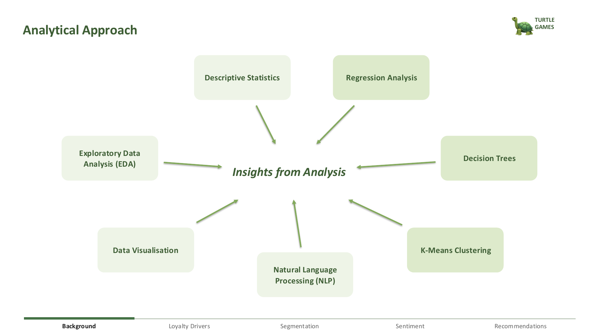
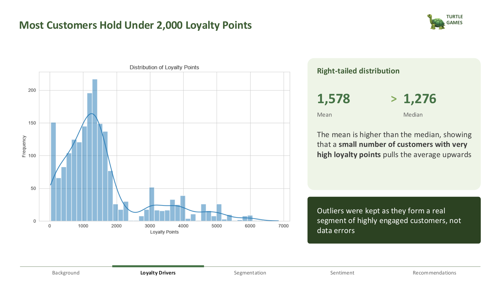
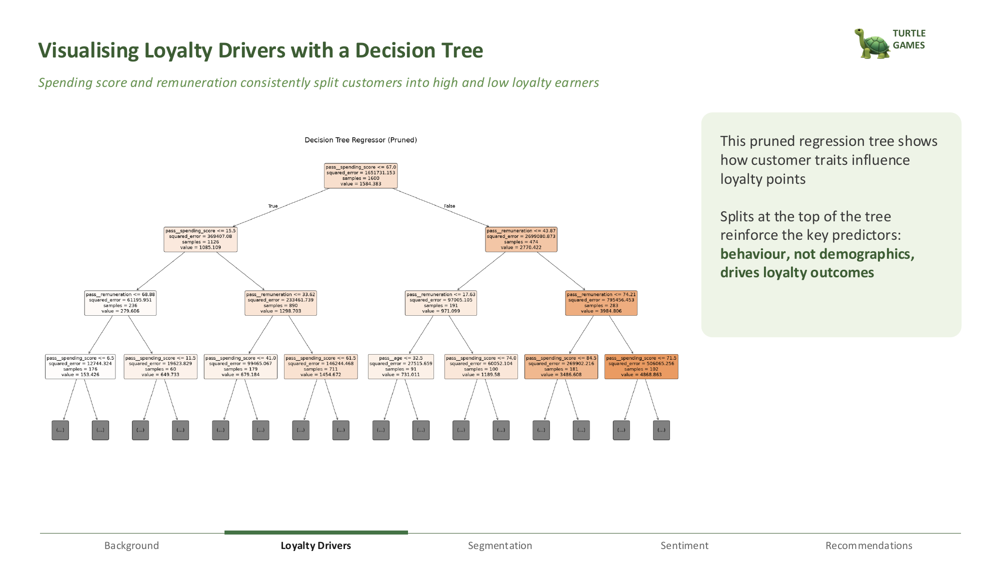
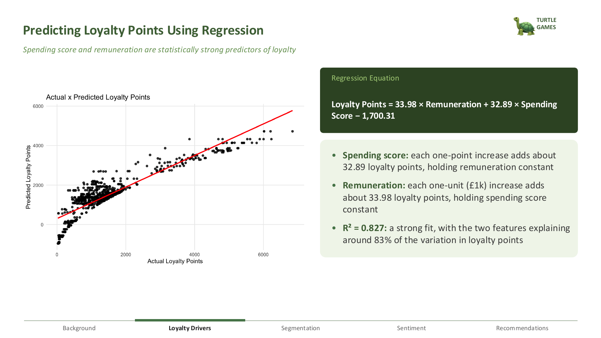
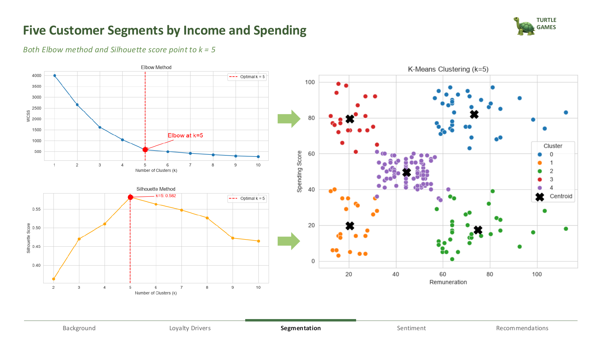
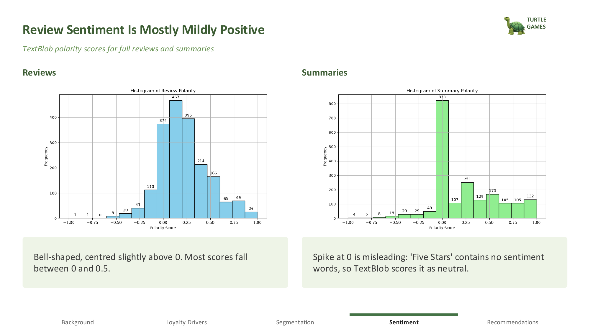

# 🐢 Turtle Games: Customer Loyalty, Segmentation & Review Analytics

An end-to-end data analytics project exploring how Turtle Games customers accumulate loyalty points, how they can be grouped into targetable segments, and what customer reviews reveal about product strengths and pain points.

## 📁 Files

- 📘 [Presentation Slides](Turtle_Games_Presentation.pdf)
- 📓 [Analysis Notebooks](Data%20Analysis%20-%20Python%20/)

## 📝 Project Description

Turtle Games is a global game manufacturer and retailer that produces and sells its own products as well as those from other companies. Its diverse product range includes books, board games, video games and toys. The company collects extensive sales and customer review data to improve overall sales performance.

## 🎯 Business Problem

Turtle Games wanted to improve overall sales performance by:

- Understanding how customers engage with and accumulate loyalty points
- Segmenting customers for more targeted marketing campaigns
- Using customer reviews to inform marketing and business improvements

## 📊 Analytical Approach Highlights

To address each business question, I applied the following techniques:

| Technique | Objective |
| --- | --- |
| Multiple Linear Regression (OLS) | Measure how remuneration and spending score affect loyalty points |
| Decision Tree Regressor | Identify the key drivers of loyalty points |
| K-Means Clustering | Segment customers for targeted marketing |
| Sentiment Analysis (TextBlob & VADER) | Use review sentiment to uncover product insights and pain points |

## 🛠️ Tools Used

- **Python:** Pandas, NumPy, Matplotlib, Seaborn, Scikit-learn, Statsmodels, NLTK, TextBlob, VADER, WordCloud
- **R:** dplyr, ggplot2, corrplot, factoextra, cluster

## 🔍 Key Insights

### 1. Loyalty Points Analysis

Customer loyalty points were found to be right-skewed, with about 80% of customers earning fewer than 2,000 points. The primary drivers of loyalty points are remuneration and spending score, which together explain around 83% of the variation in loyalty points (R² = 0.827), while age, gender and education have little to no effect.

### 2. Customer Segmentation

I identified five distinct customer segments:

* **Casual Shoppers:** Low remuneration, low spending; respond well to frequent, low-cost rewards.
* **Passionate Gamers:** Low remuneration but high spending; benefit from loyalty rewards and exclusive offers that recognise their spending.
* **Balanced Buyers:** Medium remuneration and spending; the largest segment, who respond well to personalised offers.
* **High Income Minimalists:** High remuneration, low spending; motivated by exclusive products and premium promotions.
* **Premium Enthusiasts:** High remuneration and spending; ideal for VIP programmes and personalised communication.

### 3. Sentiment Analysis

Review sentiment analysis revealed that 80% to 88% of reviews were positive, depending on the method used (TextBlob or VADER). Negative reviews focused on difficult instructions, incomplete kits and poor value for money. Turtle Games could benefit from simplifying instructions, strengthening quality checks and responding quickly to negative reviews to turn these experiences into loyalty-building opportunities.

## ✅ Recommendations

**Marketing Team**
- Reward Premium Enthusiasts with a VIP tier, exclusive offers and early access to new products.
- Target High Income Minimalists with personalised promotions to increase their spending.
- Retain Passionate Gamers, who spend heavily but earn fewer points, through loyalty rewards.
- Promote products as gifts and learning tools for children, especially around Christmas and Easter.

**Product Team**
- Simplify instructions and assembly guides.
- Strengthen quality checks to prevent incomplete kits.
- Monitor negative reviews as an early warning for product issues.

## 🚀 Professional Development

This project strengthened my ability to:

* Analyse behavioural, demographic and review text data to understand customer behaviour
* Build a structured Python and R workflow to clean, model and visualise data
* Turn technical findings into practical recommendations for the marketing and product teams
* Create customer segments that can guide targeted, real-world marketing decisions
* Use sentiment analysis to uncover product strengths and pain points from customer reviews

It also gave me hands-on experience working with both numerical and text data, and tuning predictive models so that their results can support business decisions.

## 🕹️ Visual Storytelling for Insights

### Analytical Approach

### Distribution of Loyalty Points

### Decision Tree

### Actual vs Predicted Loyalty Points

### Customer Segments

### Sentiment Comparison
